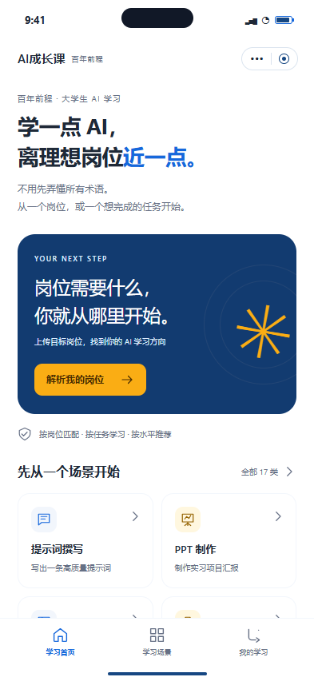
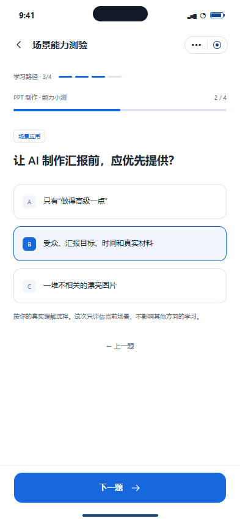
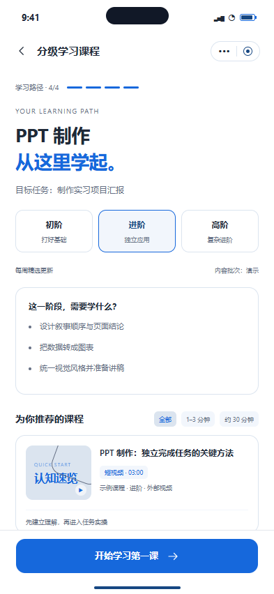
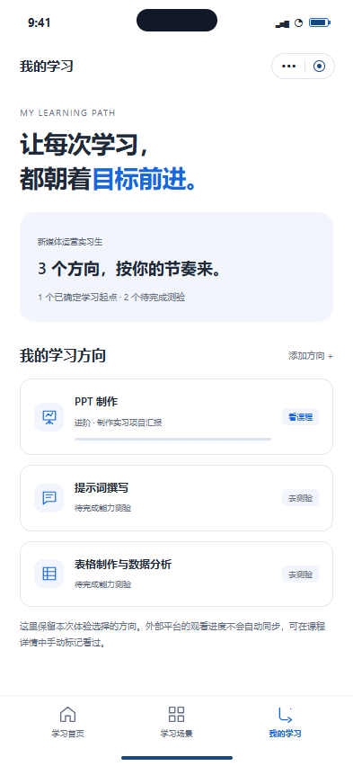

# 原型与小程序配色变更

决定：D01-COLOR-20261018，2026-10-18。用户指令：“不改变功能，只把浅绿色改为底色为白色，重点色用蓝色和橙黄色……如果改动不大就更改原型设计再进行开发”。

评估结论：局部样式修改，功能脚本没有写死颜色，不需要更换组件、模板或页面结构。已按该授权调整原型，再同步正式小程序Token和原始路径图标；继续原有开发计划。A引导式首页及D02–D09均保持原决定。

| 用途 | 固定色值 | 使用规则 |
| --- | --- | --- |
| 页面底色/白卡片 | `#ffffff` | 原浅绿页面底色改为白色 |
| 蓝色主操作/选中状态 | `#1668dc` | 主要按钮、选中标记、链接、线性图标 |
| 深蓝重点区域 | `#123b70` | 保留原主卡片的结构和层级 |
| 橙黄色强调 | `#faad14` | 首页主入口、装饰及暖色重点；不作为白底上的小字颜色 |
| 橙黄色底上的正文 | `#492c00` | 避免橙黄底配白字导致难读 |
| 正文/辅助文字 | `#1f2937` / `#667085` | 基本可读性层级 |
| 次级状态底/边框 | `#eaf2ff` / `#e4e7ec` | 小面积淡蓝状态底、卡片分隔；页面底仍为白色 |

原型CSS中的`--green`及小程序`.green`、`@mint`保留为兼容名称，值已经更新；避免为改色修改功能脚本。后台继续固定官方Ant Design Pro，不修改其模板或主题。OCR输入样例、测试媒体及历史截图不是产品界面，保留其原内容。

## 实际原型截图

以下截图直接来自修改后的本地原型，不是生成的设计图，也不代表正式小程序四代表页已经开发或验收完成。

| 首页 | 测验 | 课程列表 | 我的学习 |
| --- | --- | --- | --- |
|  |  |  |  |

[15页总览截图](design-references/white-blue-amber/overview.png)。原绿色三张参考截图保留，属于历史设计依据。原型原有课程筛选等演示行为保持原样，正式系统仍执行用户已经确认的35分钟上限及取消旧筛选的规则。

## 保护方式与复验

保留原始提交`910b4ae0704531691dbed100e62fff98cd0687a2`及11文件清单。仅`style.css`、`prototype.html`、`overview.html`、`index.html`有颜色字面值差异；另7文件保持原始内容。`app.js`、文案、链接、布局、尺寸、字体、事件和模拟状态均未变。

授权例外的精确哈希及颜色映射固定于`scripts/prototype-theme.json`。保护器不会自动接受新哈希；额外改色、改JS或删文件仍失败。可用`node scripts/build-prototype-theme.mjs`从原始Git内容复现这4个文件；脚本先检查所有文件，再写入，遇到未知修改立即停止，不重写授权哈希、不生成ZIP、不触碰仓库外文件。原`build.py`保留。

```powershell
pnpm check:prototype
pnpm test:protection
node scripts/verify-prototype-theme.mjs
```

9项保护/配色测试已通过，新增THEME-001/002/003/004分别验证仅颜色差异、后续篡改仍被拒绝、关键文字色对比至少4.5:1，以及正式小程序Token/微信导航栏/图标生成器的一致性。浏览器新旧对比共31项：15个页面状态的文案/控件/位置尺寸一致，15次交互结果一致，15个总览iframe均渲染。真实结果见[verification.json](design-references/white-blue-amber/verification.json)。首轮交互脚本误把首页首个导航定位为目录，后续修正为明确的`nav:catalog`后全部通过；没有为测试修改原型功能。

H5/微信/后台构建和10项工程浏览器回归均已通过；随后修正原生导航栏旧色，新增THEME-004，9项保护测试及微信构建再次通过，并检查产物`app.json`确实为白色。详见[本次审查](development/color-review.md)。H5不替代微信真机，D08仍待用户决定；此前M3-017长媒体实播边界仍未执行。
