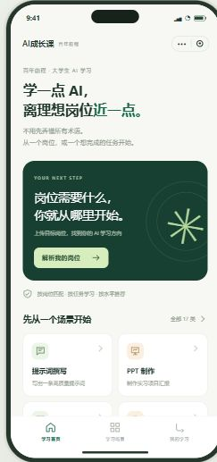
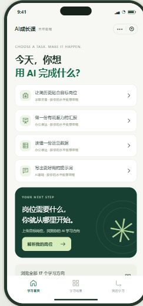
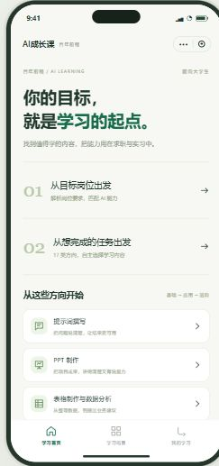

# 小程序设计参考：实际原型内的三种首页

核查日期：2026-10-17。来源固定于原型提交`910b4ae`，截图采集自其线上交互原型，没有生成新的产品视觉。

目前可观察到的是一套深绿、浅灰绿、白色卡片的视觉体系，三种首页结构。后台固定Ant Design Pro，不参与本次小程序方案选择。

**用户已于2026-10-17选择A引导式，优先岗位解析。** 下列B/C保留为比较依据，不作为正式产品中的可切换首页；最终Token和代表页仍需设计验收。

2026-10-18用户曾确认沿用绿色，随后明确授权改为白底、蓝色和橙黄色。**当前以后续配色决定为准，A结构不变。** 下列绿色截图是历史参考；[当前真实截图与配色规范](design-color-update.md)单独保存，不覆盖原截图。

| A：引导式 | B：任务式 | C：目录式 |
| --- | --- | --- |
|  |  |  |
| 岗位导入主卡片、常用场景卡片 | 简历/PPT/数据/提示词任务优先，岗位入口次之 | 编号条目平行呈现岗位、任务入口 |
| 适合：岗位驱动的新用户 | 适合：知道自己想完成什么的用户 | 适合：希望自主选择入口的用户 |
| 取舍：首次看到的任务入口较少 | 取舍：岗位入口在较靠下的位置 | 取舍：强主入口较弱，需用户先判断 |
| [打开A交互示例](https://guifanhuayi.github.io/ai-career-miniapp-prototype/prototype.html?variant=guide) | [打开B交互示例](https://guifanhuayi.github.io/ai-career-miniapp-prototype/prototype.html?variant=task) | [打开C交互示例](https://guifanhuayi.github.io/ai-career-miniapp-prototype/prototype.html?variant=editorial) |

建议：若产品优先解决“目标岗位需要学什么”，先选A。若首批用户大多没有JD，B有更低的任务入口门槛；C适合强调平衡与克制的目录结构。这些是基于页面结构的设计判断，尚无真实用户转化数据证明哪种更优。

三个示例共用后续学习流程。不能把A的主卡片、B的任务列表、C的目录排版在不同页面随意拼成三套语言，也不默认上线三个可切换首页。

## 用户选择后如何保持一致

1. 已确定A首页结构及白底、蓝色和橙黄色配色，按D01-COLOR-20261018执行。
2. 提取原型Token和组件，先审四个代表页：首页、测验、课程列表、我的学习。
3. 修正可读性：原型部分9–10px辅助字偏小，正式小程序需按设备和大字体实测；保留视觉语言不等于照搬全部尺寸。
4. 冻结设计规范、组件API、图标来源、文案规则、状态样式和视觉截图基线。
5. 新页面只组合已批准的组件；新增组件或改变主视觉先出可审示例，再更新版本。

如不认可当前风格，需要补充认可的真实品牌/竞品参考后再展开比较。当前没有观察到的风格，不冒充已有参考推荐。原型手机外框、状态栏、评审侧栏和微信胶囊模拟不进入正式业务页面。

截图只展示采集时首屏，可点击原型查看滚动与操作；它们不是新小程序的完成截图。
