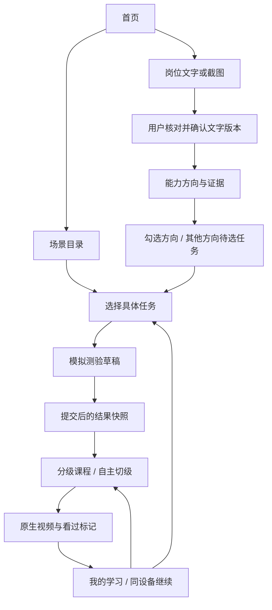

# 小程序产品开发说明手册

产品：百年前程 · AI成长课。版本：1.2产品审阅与实现跟踪稿（课程总时长≤35分钟）。日期：2026-10-18，Asia/Shanghai。

适用读者：产品、设计、开发、测试、内容运营。本文说明产品行为、审阅发现和开发验收要求；工程排期与技术实施继续见[miniapp_plan.md](miniapp_plan.md)。逐项测试见[必须要过的测试.md](必须要过的测试.md)。

**实现跟踪：**M2工程基线及M3内容管理/目录已落地；27个REST operation、真实MySQL、官方Pro场景/课程/模拟题库/审计页面、小程序绿色目录和任务选择已有本地执行证据。M3当前85项测试通过、1项实播边界待执行，详见[M3审查与证据](docs/development/m3-review.md)。3秒自制片及51门测试课均非教学内容；题库仍为模拟。岗位/OCR、测验学习闭环、我的学习、行为分析与其余代表页尚待M4–M8。本说明书的完整产品要求不会因阶段实现范围而缩减。

## 1. 结论和使用规则

原型已经清楚表达“从岗位或任务找到学习课程”的核心价值，绿色视觉、双入口、原文证据、可切换等级以及空态设计值得保留。目前它能演示流程，但不能直接视为完整商业系统的开发规格或已完成产品。

优先处理三件事：保证测验历史与自主等级互不污染；将学习记录从“场景一条”落实到“场景下多个任务”；按已定方案补齐匿名持久化和原生视频。随后完善课程数据、输入恢复、异常状态与运营发布规则。保留原有原型作为参考，修改在正式工程实施。

状态约定：

- **已定要求**：来自用户明确决定及已委托工程确定的方案，属于首期实现范围。
- **已复现问题**：在当前原型实际操作中出现，有复现路径。提出修正，不代表本轮改了原型。
- **已确认差距**：源码/页面与已定首期要求不同；可能是原型有意简化，不能据此指责原型是假成品。
- **建议优化**：产品审阅建议，尚未成为新增功能授权；影响流程或业务规则的建议须确认后再开发。
- **待外部条件**：正式课程、真实服务、微信账号/域名/真机等未具备时，不用模拟通过替代。

需求冲突处理：用户最新回复优先；[首期开发决定](docs/phase-one-decisions.md)记录已定范围；本文中的建议不能覆盖用户决定。原型与已定需求不一致时，以已定需求开发，同时保留原型原文件。

## 2. 本次实际审阅的材料

用户已确认审阅对象就是当前原型仓库。工作区基准提交`9648ef6`；设计原型基线及GitHub main为`910b4ae0704531691dbed100e62fff98cd0687a2`。本轮未合并远端、未修改原型。

| 材料 | 审阅方式与范围 |
| --- | --- |
| `index.html`、`overview.html` | 阅读总览结构，核对15个独立演示页面/状态及入口；两者为同一总览的生成/源文件 |
| `prototype-source.html`、`prototype.html` | 阅读交互模板与离线生成物，核对实际页面、评审外壳、跳转和模拟提示 |
| `app.js` | 阅读17场景、36任务、51个等级知识点组、模拟题、全部业务操作与状态变化 |
| `style.css` | 绿色视觉、字号、颜色、控件、滚动、底部操作、适配及动效处理 |
| `README.md`、`build.py`及配置 | 区分演示能力、构建生成关系和正式工程边界 |
| `docs/design-references/guide.jpg`、`task.jpg`、`editorial.jpg` | 三张截图逐张查看；是同一绿色体系的三种首页布局，不是三个不同品牌风格 |
| 现有计划、决定与测试登记 | 对照首期范围；核对“不登录、多任务、原生视频、模拟题、固定Pro后台、保留原型” |
| 线上原型 | 逐屏查看15个页面/状态的实际渲染与正文；操作复现重测回退、切级回退、表格场景测验及四章节课程 |

5个HTML文件并不代表5套独立产品；3张已有截图也不覆盖所有页面，因此本次补做了全部15屏的浏览器观察。没有找到管理后台设计HTML/截图，后台只能审查功能需求，不能宣称已审完其界面。未取得飞书原文；未做微信真机或生产API验收。

### 2.1 页面覆盖清单

| 页面ID | 原型参数 | 已查看内容 | 正式实现需要补齐 |
| --- | --- | --- | --- |
| P01 首页 | `screen=home` | 绿色A首页、岗位主入口、四个常用方向、底部导航 | 同一视觉规范、匿名使用说明、长标题/小屏验证 |
| P02 岗位文字 | `screen=jd` | 岗位选填、JD、计数、示例、分析按钮 | 草稿恢复、边界校验、提交状态 |
| P03 岗位截图 | `screen=jdimage` | 选图区、格式/10MB提示、示例、禁用按钮 | 真实选图/取消/失败、服务端校验、误操作恢复 |
| P04 识别核对 | `screen=review` | 可编辑文字、示例预览、确认 | 真实/模拟来源、空结果、错字、输入版本 |
| P05 分析中 | `screen=loading` | 步骤与等待动效 | 真实任务状态、超时/失败/返回后恢复 |
| P06 能力分析 | `screen=analysis` | 原文证据、方向勾选、修改JD | 否定/歧义、无匹配、多个方向后续任务状态 |
| P07 场景目录 | `screen=catalog` | 六分类、17方向、任务搜索 | 已发布内容、搜索恢复和分类可发现性 |
| P08 任务选择 | `screen=scene` | 单次单选任务、产出、测验入口 | 同场景多任务并存；每任务独立目标和记录 |
| P09 场景测验 | `screen=quiz` | 四题、选项、上一题、禁用下一题 | 尝试快照、提交防重、离开恢复、模拟提示 |
| P10 测验结果 | `screen=result` | 答对数、起点、回顾、重测 | 结果不可被切级改写；重测不清历史；措辞克制 |
| P11 分级推荐 | `screen=path` | 三等级、知识点、原时长筛选、课程 | 正式课程限总时长≤35分钟、取消原筛选；空态与两种等级分开 |
| P12 课程详情 | `screen=course` | 封面、目录、适用人群、外链、手动标记 | 原生video、正确章节/时长、来源/授权、播放恢复 |
| P13 我的学习 | `screen=plans` | 已分级/待测方向、添加方向 | 多任务展示、持久化、真实进度含义、来源区分 |
| P14 学习空态 | `screen=empty` | 岗位、场景双入口 | 与请求失败/数据丢失状态区分 |
| P15 搜索无结果 | `screen=noresults` | 清除筛选、恢复目录 | 与加载失败区分，保留/清除条件一致 |

参考入口：[完整总览](https://guifanhuayi.github.io/ai-career-miniapp-prototype/overview.html)、[交互原型](https://guifanhuayi.github.io/ai-career-miniapp-prototype/prototype.html)。以上页面是浏览器原型，不是新微信小程序完成截图。

## 3. 产品定位与首期边界

目标用户是希望提高实习、求职和实际任务能力的大学生。用户无需先理解所有AI工具，先选择目标岗位或一个想完成的任务，再获得学习方向、模拟学习起点及课程。

首期保留：绿色A引导式首页、17类场景、36个任务、JD文字/截图核对路径、模拟四题测验、三级学习内容、课程推荐、原生播放、匿名学习记录、多任务、Ant Design Pro内容后台、请求观测及行为分析。

首期不做：微信/手机号/平台登录或绑定、支付、学生上传售课、论坛、内置简历/PPT/图片/视频生成工具、AI自动评定作品、公开部署或发布。模拟题后续由用户正式题库替换，不能将四道示例题包装成专业能力认证。

本地可运行标准：前台操作真实调用本地API，数据写入MySQL，后台发布影响前台内容，重启后记录可恢复；OCR/分析外部依赖可显式模拟，视频使用可控测试资源。当前仓库尚无这些正式应用，本文描述的是开发目标。

## 4. 产品Review：问题与有价值的修改建议

优先级：P0为首期系统交付阻断；P1为核心正确性、信任或可恢复性问题；P2为体验优化。优先级针对正式系统验收，不要求修改或删除被保留的原型文件。

| 编号/级别 | 发现、证据与影响 | 具体修改建议 | 性质/验收关联 |
| --- | --- | --- | --- |
| R01 / P1 | 结果页→重新测验→返回→答题回顾，四题“你的答案”均为`undefined`。`startQuiz`清空同一答案数组。 | 新建草稿attempt；旧结果只读旧快照。取消/返回重测不改旧成绩、答案及解析。 | 已复现；MT-076、MT-077 |
| R02 / P1 | 3/4进阶结果→课程→切高阶→返回，结果也成“高阶”，但仍3/4。测验建议被自主选择污染。 | `recommendedLevel`归属于已提交attempt，`selectedLevel`只控制当前学习；结果页永远读前者。 | 已复现；MT-078、MT-080 |
| R03 / P1 | 表格场景高阶系统课第4章时长为`undefined`；源码只有三个时长。51组知识点中16组有四项，影响范围不只一个页面。 | 章节作为课程独立数据，完整提供/校验标题、顺序、时长；未知值显示待完善，不显示程序字面值。 | 已复现+数据检查；MT-090、MT-091 |
| R04 / P1 | 课程总时长固定03:00/28:00，但知识点有2/3/4项，目录时长按固定数组拼接；“3个关键点”也未必是3项。 | 课程内容与等级知识点分开建模；总时长来自媒体/课程元数据；非三点课程不写固定“三个”。 | 源码确认；MT-090、MT-092 |
| R05 / P0 | 原型按scene查找并覆盖计划，同一场景第二个任务会覆盖第一个。与用户确认的多任务不符。 | 访客+场景+任务唯一；按场景分组展示独立任务卡，测验/等级/位置互不覆盖。 | 已定需求差距；MT-061、MT-106 |
| R06 / P0 | 全部记录在内存，刷新清空；首期决定要求匿名持久化。 | 服务端访客凭据、MySQL业务记录、同设备恢复；提示清存储/换设备暂不能找回，不偷偷调用微信登录。 | 已定需求差距；MT-103至MT-109 |
| R07 / P0 | HTML课程按钮/封面仍跳同一个B站网页，正式方案已定原生受控媒体。 | 正式详情使用原生video；缺素材显示待配置；测试片显式标注；来源页与媒体地址分开。 | 已定需求差距；MT-089、MT-093至MT-102 |
| R08 / P1 | 正则将“无需PPT”判为直接要求，将“短视频脚本”匹配到图片视频生成。原文片段真实不代表结论正确。 | 否定、职责/优先项和歧义样例进入标注测试；证据区分直接要求/延伸建议；不能判断时降低断言。 | 源码与示例确认；MT-044、MT-045 |
| R09 / P1 | “从进阶开始，刚刚好”“已有一定基础”等措辞强于四道模拟题能证明的内容；页脚虽已有非认证说明，主标题仍偏肯定。 | 改为“模拟建议：从进阶内容开始”，就近展示“仅验证学习流程，可自主调整”；不声称已具备岗位胜任力。 | 文案建议；MT-074、MT-075 |
| R10 / P1 | 示例文字会直接替换输入；截图下一步清空JD；重测返回已暴露草稿/已提交状态共用风险。 | 正式工程分别保存文字草稿、图片核对稿和提交快照。会替换已有内容时明确说明并可取消；失败保留可恢复输入。 | 交互建议/完整性；MT-022、MT-029、MT-035 |
| R11 / P1 | 多方向确认后只进入首方向，其他方向看似已有任务，实际被默认设为task=0。用户难区分选方向和选任务。 | 其他方向标为“待选任务”；真正选择任务后建任务计划；提示还剩几个方向。禁止把默认首任务当用户已确认目标。 | 产品澄清建议；MT-049、MT-050 |
| R12 / P1 | “我的学习”标题使用全局最近岗位，新JD可能让旧方向看上去也来自新岗位。 | 每条方向候选/任务计划保留来源标签；跨岗位汇总用中性标题，不用最后输入的岗位覆盖全部来源。 | 源码确认；MT-112 |
| R13 / P1 | 原型进度是本等级两门占位课的手动标记比例；没有说明是标记数，容易被读为真实播放/任务完成率。 | 展示“已手动标记x/y门”；播放位置单列；无课不计算百分比；当前结果不能叫掌握度。 | 语义修正；MT-100、MT-110 |
| R14 / P1 | 分析步骤预先显示对勾，1.1秒定时切页；没有失败、超时、退出后恢复的设计。 | 用后台任务状态显示进行中/失败/成功；返回不丢请求；旧输入结果不能覆盖新版本。 | 原型简化/正式缺口；MT-038至MT-040 |
| R15 / P1 | 除学习空态、搜索无结果外，缺少无课程、课程下架、播放失败、凭据失效、接口失败等画面。 | 按第9节状态清单补同风格组件；“无数据”与“请求失败”分开，失败提供可执行恢复动作。 | 设计缺口；MT-084、MT-098、MT-114 |
| R16 / P1 | 正文辅助色`#849080`对`#f7f8f4`计算对比约3.13:1；多处9–10px小字和浅线框在手机上难读。 | 保留绿色体系，提高重要辅助文字对比与字号；主操作、说明、错误、禁用状态有明确层级，真机/大字体验收。 | 源码计算+视觉观察；MT-139至MT-142 |
| R17 / P2 | A首页大标题+说明+主卡占首屏多数；分类条后半部分需横滑，缺少明显提示。 | 在不改A结构的前提下压缩重复引导语，保留清晰岗位主入口和场景次入口；分类提供可发现的横滑提示。 | 优化建议，非重设计；MT-011、MT-055 |
| R18 / P1 | “每周精选”“按日/小时跟进”是演示文案，没有对应运营能力或发布记录。 | 上线只展示实际审核/更新时间与版本；更新频率承诺需有负责人及执行机制。 | 内容运营建议；MT-087、MT-118 |
| R19 / P1 | 任务介绍大量共用泛化描述；不同PPT任务却共用同一学习产出，不利于用户判断推荐相关性。 | 每任务补“适用情境、所需材料、预期产出、完成检查”；不增加内置生成/上传作品功能。 | 内容建议；MT-059、MT-060 |
| R20 / P1 | 未找到Pro后台设计，内容维护、发布、题库版本、下架影响尚无界面可核对。 | 在固定Pro模板内补课程、题库、场景任务、发布、分析五类流程设计并逐一验收，不声称当前后台已完成。 | 设计缺口；MT-115至MT-124 |
| R21 / P1 | 课程章节名称按18字截断且无展开；知识点被直接当作章节。 | 章节独立于知识点；标题允许换行或查看完整内容；章节是否能点击要与真实媒体结构一致。 | 源码确认；MT-090、MT-101 |
| R22 / P1 | 评审外壳的跳步、全页种子、重置、三首页切换只适合评审，可能被误当正式功能。 | 原型保留；正式构建不包含评审种子/跳步/重置入口，普通访客首次进入不带示例成绩和计划。 | 交付边界；MT-003至MT-010、MT-145 |
| R23 / P1 | 原型有“1–3分钟/约30分钟”筛选；用户已明确取消原方案，也不采用类型筛选提案。 | 正式产品仅提供实际总时长≤35分钟的课程，包含35:00；不分短视频/系统课筛选，显示实际时长；后台/API共同限制，原型保留。 | 用户已定规则，覆盖原建议；MT-082、MT-083 |

### 4.1 三个已复现问题的证据

1. **重测返回丢回顾**：打开`prototype.html?screen=result`→重新测验→顶部返回→查看答题回顾；仍显示旧分数，但答案变成`undefined`。源码定位`app.js:91、93、96`。见[实际截图](docs/review-evidence/retake-answer-loss.jpg)。
2. **自主等级污染测验结果**：同一结果入口→查看适合我的课程→高阶→顶部返回，3/4的旧结果显示高阶。源码定位`app.js:63、96`。本轮已浏览器复现。
3. **第四章时长缺失**：场景目录→表格制作与数据分析→分析一份运营数据→四题选A/B/B/B→推荐课程→系统课→课程目录，第4章时长为`undefined`。源码定位`app.js:64、68`。见[实际截图](docs/review-evidence/chapter-duration-undefined.jpg)。

以上行号固定指原型基线。问题已记录，原型源码未改；正式系统回归用例需按目标行为重新执行。

## 5. 关键概念与规则

| 概念 | 产品定义及不变量 |
| --- | --- |
| 访客 | 无登录界面；服务端凭据确定本人记录；不能用客户端随意填写的ID读取他人数据 |
| 场景 | 17类学习方向，如PPT、简历；一个场景包含多个任务 |
| 任务 | 用户当前要完成的具体目标；同场景可并存多个任务，同一任务重复进入不重复建计划 |
| 方向候选 | 从JD勾选但尚未真正选择任务的方向；建议保留待选状态，不与已确认任务混算 |
| 测验尝试 | 某访客、某任务、某题库版本的一次答题；草稿和已提交结果分开，提交后答案/分数/解析快照稳定 |
| 推荐等级 | 服务端根据该次模拟测验计算的学习起点；0–1题初阶、2–3题进阶、4题高阶；不是职业能力认证 |
| 自主等级 | 用户在课程页选择的当前浏览/学习等级，不反写旧测验推荐等级 |
| 学习计划 | 唯一键为访客+场景+任务；保存当前任务、建议、自主等级、继续位置；历史attempt不被重测覆盖 |
| 课程 | 有稳定courseId、来源、媒体、实际总时长、内容和发布版本；正式可用课程须满足0<时长≤2100秒；可映射多个任务，不能用列表序号作ID |
| 看过标记 | 访客对courseId的自我声明，可撤销；与播放器位置、结束事件分别保存 |
| 内容发布 | 草稿经校验后供前台展示；旧attempt不受题库新版本篡改；下架课程保留历史引用并提示不可用 |

同一课程跨任务出现时，共享该访客的课程看过标记和课程播放位置；每个任务自己的测验/等级/任务进度仍独立。若未来要求“每任务同一课也从头独立计进度”，需作为业务变更确认，当前不这样扩展。

## 6. 业务流程与保存时机

保存规则：

1. 编辑文字/核对文字时保留草稿；用户确认后生成输入版本，分析只读该版本。切换输入方式或示例时不得静默毁掉未确认草稿。
2. 勾选方向不等于完成任务选择。已确认任务才建立对应任务计划；方向候选与任务计数分列。
3. 答题按attempt保存草稿；上一题/返回不丢已选项。新重测另建attempt，旧结果可稳定查看。
4. 最后提交由服务端判完整性、评分、防重，失败可重试；客户端不上传一个分数让服务器直接相信。
5. 用户切级只改变当前任务自主等级；重测成功才按规则更新当前建议等级，旧attempt继续保留。
6. 播放位置、结束事件、手动标记分别保存；关闭再进恢复可用课程与位置。课程下架/版本变化时先校验，不跳到无关片源。
7. 免登录只免去身份输入流程，仍需校验归属。清存储/换设备将形成新访客，不能宣称自动找回或跨设备同步。

## 7. 逐页开发说明

### P01 首页

继续使用绿色A布局：岗位解析为主操作，学习场景为次入口，底部为“学习首页/学习场景/我的学习”。常用四场景来自原型提示词、PPT、数据、简历。统计/运营推荐内容没有数据时不虚构“热门”人数。

首次进入不出现登录弹窗或预置学习成绩。文案避免将学习课程说成已经提高就业结果；示例入口明确是演示。评审侧栏、手机外框和模拟胶囊不是正式页面元素。验收：MT-011至MT-018。

### P02/P03 岗位输入

岗位名称选填，JD必填且原型上限8000。正式契约应统一字符计数口径，不能一端按字节、一端按字符；岗位名称上限和超长展示在接口冻结时明确，未定前不擅自截断用户内容。图片单张、JPG/PNG/WEBP、不超过10MB；客户端与服务端都校验实际格式，不能只信扩展名。

选图取消不当报错；新图无效时说明仍保留哪份有效输入。示例不得被当成用户截图识别成功。提交中防连点，失败保留稿件、提供重试。验收：MT-019至MT-032。

### P04 核对文字

保留图片预览与可编辑文字；确认后才分析。清楚标记真实识别、示例、用户手工输入。首期任意真实截图没有OCR结果时，应提示补录，不能自动套新媒体JD。替换示例需避免静默覆盖。验收：MT-033至MT-037。

### P05 分析中

展示实际queued/running/终态与处理说明；不可预先把未完成步骤全部勾选。超时/失败回到可编辑输入或重试；离开再进可查同一任务，旧请求不能覆盖新输入。验收：MT-038至MT-040。

### P06 能力分析

展示目标岗位、匹配方向、证据或延伸建议、选择数量和确认操作。直接依据可追溯到用户确认文本，不能把“相关关键词”扩大成确定岗位资格。全部取消时不能继续；无明确匹配时允许通用建议并解释来源。

多个方向确认后，明确当前进入哪一个、其余如何继续；待选任务不伪装为已选首任务。验收：MT-041至MT-050。

### P07 场景目录 / P15 无结果

保留六类筛选与17方向，支持场景名称、描述、任务名称及已约定英文标识搜索；分类与关键词取交集。无结果允许清除条件，清除后恢复已发布目录。返回是否恢复搜索、分类和滚动应一致；原型目前重新进入目录会清空，建议正式页面从任务返回时恢复，Tab主动重新开始另作统一定义。

分类不能仅靠颜色表达当前项，后半分类要可发现。接口失败不能显示“没有匹配方向”。验收：MT-051至MT-058。

### P08 任务选择

一次操作单选任务，不限制同场景累计多个任务。显示任务名称、适用情境、材料和产出；默认首项若作为默认值，应清楚显示且在继续时由用户确认，不把未进入该页的其他方向自动建成首任务。

PPT例子：实习汇报突出个人行动、项目证据和下一步；答辩突出研究问题、方法、结果与局限；面试展示突出岗位关联、个人贡献及可追问证据。以上是建议的内容差异，未增加作品上传或AI批改。验收：MT-059至MT-064。

### P09/P10 测验与结果

首期17场景每场景4道模拟题，含2道共同题及2道场景题；应显示“模拟”，题库与评分版本化。未答不能下一题，上一题保留答案，末题明确提交；网络失败不产生半份结果。

结果同时展示答对数、推荐起点、模拟提示、答题回顾、重测和课程入口。建议弱化“刚刚好/已有能力”的断言。答题回顾读取提交时题目/选项/答案/解析；重新测验不销毁它。自主切级后回结果，成绩和建议不变。验收：MT-065至MT-078。

### P11 推荐课程

顶部展示任务、当前等级及测验建议；用户可浏览三级，切级更新知识点/课程但不重写成绩。真实课程按发布内容返回，不能假定每等级永远两课。

用户已决定取消原有时长/类型筛选：不再展示“1–3分钟/约30分钟”或“全部/短视频/系统课程”筛选按钮。与当前场景/任务/等级相关的课程，只要实际总时长不超过35分钟且满足发布/授权条件，均可进入课程列表；卡片展示实际时长。

时长判据为`0 < durationSeconds <= 2100`，以一门课程实际总长为准；34:59、35:00符合，35:01及任何超过2100秒的值不符合，不能靠显示取整放行。无有效时长的课程保留待完善草稿，禁止正式发布/推荐；直接课程ID也不能绕过。无需为此自动剪辑、拆分或改写课程时长。后台、API、前台遵守同一规则。原型原筛选保留不改。

无合格课程时显示本等级暂无课程，可切其他等级或返回，底部不能跳无效“第一课”。验收：MT-079至MT-088。

### P12 详情与播放

采用已定原生video，媒体来源/授权、标题、封面、时长、适用等级、所学内容及课程目录相互对应。知识点数量不等于章节数量；单视频章节若只有时间索引，应称“内容时间点”，没有可跳转数据时不要画成可点击章节。

正常支持开始、暂停、继续、合法位置恢复；错误/下架/无媒体状态可返回，不能标看过。播放位置、客户端结束、手动标记分列；手动标记可撤销。同一课程的封面入口和底部主操作指向同一courseId/媒体，不能一个B站、一个本地播放器。验收：MT-089至MT-102。

### P13/P14 我的学习与空态

以场景分组、任务为卡片单位；显示任务名、当前自主等级、测验/学习状态与下一步。待选任务的方向、待答测验和已分级任务不混称“已完成”。课程标记数显示分母及其含义；多个岗位/自主入口的来源清楚。

空态仅用于成功读取且确无记录；请求失败显示失败状态。提供岗位/场景入口；恢复后定位原任务。显示简短说明：“记录与当前设备关联，清除数据或更换设备后暂无法找回。”验收：MT-103至MT-114。

## 8. 管理后台说明

当前没有后台HTML/截图，以下为既定业务所需的页面行为，不代表已经完成视觉审查。模板固定Ant Design Pro；页面沿用Pro布局、表单、表格、反馈与分析组件，不仿照小程序绿色首页另造后台。

| 管理流程 | 必要字段/操作 | 必须避免的错误 |
| --- | --- | --- |
| 场景/任务 | 稳定ID、名称、分类、说明、材料、产出、知识点、排序、草稿/发布/下架 | 修改名称破坏旧学习计划；默认任务覆盖同场景其他任务 |
| 题库 | 场景/任务适用范围、题目、选项、答案、解析、模拟标记、规则/版本 | 答案提前给前台；新题改掉历史成绩；模拟题取消标记冒充认证 |
| 课程/媒体 | 标题、来源、作者、授权记录、受控媒体、真实时长、目录、等级/任务关联 | 网页当媒体；无授权正式发布；缺第4章时长；全课指向同一无关片源 |
| 内容发布 | 校验、预览、发布、下架、版本和操作记录 | 草稿被前台读到；下架删除历史引用；并发编辑静默覆盖 |
| 行为分析 | 环境、时间范围、访客、漏斗、留存、播放/手动标记、请求质量 | 测试数据混入正式；跨任务拼漏斗；点击即完课；泄露JD/截图/凭据 |

首期后台/管理API只限本机；不做登录不等于允许公网编辑。公开部署及管理员鉴权随D08另定。验收：MT-115至MT-124。

## 9. 必须补齐的状态与文案

| 场景 | 正常/空态 | 异常与恢复 |
| --- | --- | --- |
| 输入 | 空白、草稿、有效截图、示例 | 超长、格式/体积错误、选图取消；保留上次有效稿 |
| OCR/分析 | 等待、处理、可编辑结果、无明确匹配 | 失败、超时、低质量/空结果、旧版本返回；补录/重试/返回 |
| 测验 | 未答、已答、草稿、已提交结果、重测草稿 | 提交失败、防重冲突、题库更新、恢复；旧结果保持 |
| 推荐 | 有合格课、本等级无课、全部课程超35分钟/时长无效 | 请求失败、内容下架；可切级/返回，不出现已取消的时长筛选 |
| 媒体 | 待配置、可播、暂停、继续、客户端结束、手动看过 | 断网、解码/域名失败、失效、下架；错误不计完成 |
| 我的学习 | 无记录、待选任务、待测、已有建议、继续学习 | 请求失败、凭据无效、内容不可用；不伪装成全新空态 |

建议文案：“暂无本等级课程”“模拟测验，仅用于学习起点演示”“播放位置已保存”“你已手动标记看过”“加载失败，点击重试”。“数据已永久保存”“已掌握”“认证完成”“每小时更新”只有证据与真实能力支持时才能使用。

## 10. 接口、数据与分析的产品要求

REST前缀`/api/v1`，Swagger/OpenAPI对应实际请求/响应、错误、分页、归属、版本、幂等，不只列一个接口名字。客户端页面成功状态须基于真实API结果，错误不能统一返回200。后台和前台读取同一发布内容。

关键资源：自动匿名访客、截图/核对JD、分析任务、场景/任务、测验attempt/答案/提交、任务计划、课程、播放位置、看过标记、事件批次、后台内容版本。确切接口路径/字段在工程契约冻结；本文不伪称尚未开发的接口已经存在。

主流程数据写入成功与业务成功事件保持一致；请求日志记录requestId、路由模板、耗时、状态、环境，禁止带凭据、截图或完整JD。行为按eventId去重，客户端重发不重复计数。

分析已定：UTC存储，北京时间自然日报表；匿名访客DAU为实际学习行为去重；首次学习日计算D1/D7；24小时内按访客+flow+任务匹配有序漏斗；测试/演示环境排除；打开、播放开始/结束、最后位置、手动看过分列。原始行为90天、请求明细14天、日聚合365天，业务记录另管；详细规则见[首期D07决定](docs/phase-one-decisions.md)。验收：MT-125至MT-138。

## 11. 功能入口与测试索引

下表“链接”包含按钮、Tab、卡片、选项、上传和弹层入口。原型参数仅用于评审定位，正式路由待工程确定。正常、返回、重复点击、失败、恢复都要测试，不能只证明“点了能跳页”。

| 入口ID | 当前入口/操作 | 目标、数据变化与分支 | 对应测试 |
| --- | --- | --- | --- |
| L01 | 底部“学习首页” | 回首页，当前Tab反馈；不重建访客/计划 | MT-015、MT-016、MT-018 |
| L02 | 首页“解析我的岗位” | 打开JD输入，不直接分析或生成学习成绩 | MT-012、MT-019 |
| L03 | 首页“全部17类” | 场景目录，完整已发布方向 | MT-013、MT-051 |
| L04 | 首页四个常用场景卡 | 对应场景任务页，ID和目标一致 | MT-014、MT-059 |
| L05 | 底部“学习场景” | 目录；分类/搜索状态按统一导航策略 | MT-015、MT-057 |
| L06 | 底部“我的学习” | 本访客任务列表或真实空态 | MT-015、MT-105、MT-111 |
| L07 | 次级页顶部返回 | 返回合理上一业务页；保持稿件/结果/任务 | MT-025、MT-069、MT-076、MT-078 |
| L08 | “粘贴岗位文字” | 文字输入模式；保留对应草稿 | MT-025 |
| L09 | “上传岗位截图” | 图片模式；不自动确认或替换文字稿 | MT-025、MT-029 |
| L10 | “没有JD？先用示例体验” | 标注示例；已有输入的替换可取消/恢复 | MT-022、MT-024 |
| L11 | 点击上传/重新选择截图 | 选择、取消、预览、替换；类型/大小/内容失败 | MT-026至MT-030 |
| L12 | “使用一张示例截图” | 进入标注的示例核对页，不声称真实OCR成功 | MT-033、MT-034 |
| L13 | “分析岗位要求” | 有效文本版本→分析任务；空/超长/失败/重复 | MT-019至MT-021、MT-031、MT-032 |
| L14 | “识别并核对文字” | 有有效图片才可继续；进入核对，不直接推荐 | MT-027、MT-030、MT-033至MT-037 |
| L15 | 核对页“使用示例文字” | 明确替换与模拟来源，不混淆用户截图结果 | MT-034、MT-037 |
| L16 | “确认文字，匹配能力” | 提交用户确认后的版本；空稿阻止 | MT-035、MT-036、MT-042 |
| L17 | 能力方向勾选行 | 勾选/取消与计数一致；全部取消禁用 | MT-047、MT-048 |
| L18 | “修改岗位描述” | 回可编辑稿；新分析不篡改旧计划 | MT-040、MT-050 |
| L19 | “确定学习方向” | 当前方向继续选任务，其余待继续，不丢多选 | MT-049、MT-050 |
| L20 | 场景搜索框 | 名称/描述/任务/约定标识搜索，大小写和空白 | MT-053、MT-054 |
| L21 | 分类按钮（全部及六类） | 分类与搜索交集、状态可辨、可横滑 | MT-052、MT-054、MT-055 |
| L22 | 17个场景目录行 | 正确任务列表、内容版本与场景ID | MT-051、MT-059、MT-064 |
| L23 | 36个任务选项 | 本次单选，不覆盖已有同场景其他任务 | MT-059至MT-062 |
| L24 | “测一测，找到学习起点” | 当前任务新/恢复草稿，非另一个任务的答案 | MT-063、MT-065、MT-069 |
| L25 | 测验A/B/C选项 | 当前题单选；改选与返回保留 | MT-066至MT-068 |
| L26 | “下一题” / “查看学习建议” | 未答禁用，末题提交防重与失败重试 | MT-066、MT-070至MT-073 |
| L27 | “上一题” | 回上一题保留答案，不重新计分 | MT-068 |
| L28 | 结果“查看答题回顾” | 读取旧attempt快照，不使用重测空数组 | MT-075至MT-077 |
| L29 | 回顾弹层关闭按钮/遮罩 | 只关弹层，不丢成绩/改变任务 | MT-075、MT-076 |
| L30 | “查看适合我的课程” | 本任务课程，初始等级与建议一致 | MT-079、MT-081 |
| L31 | “重新测验” | 独立新attempt；返回旧结果仍可读 | MT-076、MT-077 |
| L32 | 初阶/进阶/高阶按钮 | 改自主等级与展示，不改推荐成绩和其他任务 | MT-078、MT-080、MT-081 |
| L33 | 原型时长筛选（正式产品取消） | 正式列表统一限定总时长≤35分钟；无时长/类型筛选按钮，显示实际时长 | MT-082至MT-084 |
| L34 | 课程卡片/卡片封面 | 当前courseId详情，不能串任务/等级 | MT-086、MT-089 |
| L35 | “开始学习第一课” | 当前等级列表第一门≤35分钟有效课；无课禁用/替代 | MT-084、MT-085 |
| L36 | “查看我的其他学习方向” | 我的学习并保留当前记录 | MT-088、MT-105 |
| L37 | 课程封面播放入口 | 正式工程原生video；同一课同媒体 | MT-089、MT-093 |
| L38 | 详情底部视频主按钮 | 与封面同courseId，处理中/无媒体反馈 | MT-089、MT-093、MT-098 |
| L39 | “标记看过” / “取消看过” | 本访客本course幂等，可撤销，不改成绩 | MT-099、MT-100、MT-110 |
| L40 | 我的学习“去测验”任务行 | 当前待测任务或草稿，不串场景 | MT-063、MT-106、MT-113 |
| L41 | 我的学习“看课程”任务行 | 当前任务自主等级、课程、继续位置 | MT-096、MT-106、MT-113 |
| L42 | 我的学习“添加方向+” | 进入目录，不清已有任务 | MT-062、MT-105、MT-113 |
| L43 | 学习空态两个入口 | 分别进入JD/目录，空态来自成功读取 | MT-111、MT-114 |
| L44 | 搜索无结果“清除筛选” | 清空关键词及分类，恢复目录 | MT-056 |
| L45 | 正式原生播放器控件 | 播放/暂停/位置/错误/恢复；原型尚无对应控件 | MT-093至MT-102 |

评审专用入口另测，不进入正式业务：品牌/总览入口MT-006；总览15张卡MT-003；适应宽度/全部适应MT-004；缩放按钮/滑杆/100%MT-005；手机预览适应/原尺寸MT-007；三首页箭头及键盘切换MT-008；侧栏五步跳转MT-009；重置确认/取消及弹层MT-010。后台入口当前无HTML，按MT-115至MT-124在Pro工程完成后测试。

## 12. 内容范围快照

以下清单来自本次原型数据，是首期模拟内容输入的可追溯快照。不是正式课程资源清单，也不代表已完成教学有效性审查。正式题库后续由用户提供；所有AI产品/模型/平台知识正式发布前应由内容负责人核对时效，当前不凭空扩写为新课程。

### 12.1 场景、全部任务和学习产出

| 场景ID / 分类 | 场景 | 任务（本次原型全部36项） | 原型学习产出 |
| --- | --- | --- | --- |
| prompt / AI基础 | 提示词撰写 | 写出一条高质量提示词 建立岗位专属提示词模板 | 一组可复用的任务提示词 |
| skill / AI基础 | 创建 Skill | 制作简历检查 Skill 制作汇报材料整理 Skill | 含说明、模板和示例的 Skill 文件包 |
| api / AI开发 | API 调用原理 | 完成首次模型 API 调用 让表单获得结构化 AI 结果 | 一份可运行的调用示例及说明 |
| models / AI基础 | 大模型能力排名与选型 | 为学习任务选择模型 制作岗位任务模型对比表 | 一份有测试依据的模型选型表 |
| plugins / 工具连接 | 插件使用 | 用插件完成资料整理 组合插件完成办公任务 | 一套可重复使用的插件操作流程 |
| agent / AI开发 | Agent 搭建 | 搭建求职资料整理助手 搭建岗位研究助手 | 一个可演示的单任务智能助手 |
| workflow / AI开发 | 工作流搭建 | 搭建资料到周报工作流 搭建内容整理工作流 | 一套可运行的多节点任务流程 |
| mcp / 工具连接 | MCP 连接 | 连接一个现成 MCP 服务 为助手接入资料查询工具 | 一份连接配置与工具调用演示 |
| rag / AI开发 | RAG 检索 | 搭建求职资料知识库 制作公司资料问答助手 | 一个可引用原文的知识库问答案例 |
| ppt / 办公表达 | PPT 制作 | 制作实习项目汇报 制作课程答辩 PPT 制作面试作品展示 | 一份可编辑的汇报 PPT 与讲稿 |
| data / 办公表达 | 表格制作与数据分析 | 分析一份运营数据 制作求职投递跟踪表 分析问卷并制作图表 | 一份含公式、图表和结论的分析表 |
| resume / 求职准备 | 简历制作与排版 | 优化实习申请简历 排版一页式求职简历 | 一份针对目标岗位的一页式简历 |
| interview / 求职准备 | 面试模拟与准备 | 练习岗位模拟面试 练习项目经历连续追问 | 一份回答记录与针对性改进清单 |
| research / 求职准备 | 信息检索与行业调研 | 完成目标公司调研 制作行业与竞品分析 | 一份带来源和局限说明的调研报告 |
| media / 内容设计 | 图片视频生成 | 学习制作活动海报 学习制作宣传视频分镜 | 一份视觉作品方案及生成操作记录 |
| coding / AI开发 | AI 编程 | 开发一个求职跟踪小工具 编写数据整理脚本 | 一个可运行的项目及使用说明 |
| prototype / 内容设计 | 产品原型制作 | 制作微信小程序原型 制作求职工具交互原型 | 一套可交互原型及核心流程说明 |

### 12.2 三等级知识点快照

共51个等级组、168个知识点分项。它们是推荐内容组织依据，不能直接当作课程章节或正式测量标准；课程时长和章节必须单独维护。

| 场景 | 初阶内容 | 进阶内容 | 高阶内容 |
| --- | --- | --- | --- |
| 提示词撰写 | 目标、背景、材料、限制与格式 用清晰指令完成基础任务 检查答案中的事实和遗漏 | 任务拆解与示例引导 结合资料进行多轮修改 比较不同提示词的结果 | 建立参数化模板与版本记录 设计测试样例及评分标准 定位失败原因并验证优化 |
| 创建 Skill | 理解 Skill 组成与适用平台 认识 SKILL.md 使用现成 Skill 完成一次任务 | 写清用途、触发条件与执行步骤 添加模板和参考材料 测试触发及输出 | 整合脚本与工具 按需组织资料 建立评估样例、权限边界和版本维护机制 |
| API 调用原理 | 客户端、服务端与 HTTP 请求响应 接口地址、密钥、JSON 和 Token 完成首次调用 | 通过 SDK 或 HTTP 工具传参 管理上下文、流式响应和结构化输出 处理错误及用量 | 工具调用与批量处理 超时、重试和限流 密钥保护、日志、成本及效果监测 |
| 大模型能力排名与选型 | 区分文本、推理、编程和图像能力 认识模型版本和基准测试 阅读榜单 | 理解评分方法与测试条件 比较中文表现、速度、费用、上下文和工具支持 | 建立岗位任务测试集 匿名对比与重复测试 分析榜单偏差并定期更新选型报告 |
| 插件使用 | 理解插件用途与授权 安装或连接可信插件 完成一次搜索或文档任务 | 按任务选择并组合插件 检查返回结果 排查连接、权限及格式问题 | 建立操作流程与替代方案 评估可靠性 最小权限及关键操作确认 |
| Agent 搭建 | 目标、指令、知识与工具的关系 使用模板搭建单任务助手 检查输出 | 配置工具、知识库与状态 设计任务拆解和执行步骤 加入人工确认 | 设置执行及停止条件 处理异常和恢复 评估成功率并管理权限、耗时及成本 |
| 工作流搭建 | 输入、节点与输出 使用现成模板 搭建简单顺序处理流程 | 变量映射、条件、循环与并行 连接模型、接口和表格 调试节点 | 子流程复用 异常、重试和去重 人工审核、运行日志及稳定性评估 |
| MCP 连接 | 理解主机、客户端和服务器 连接现成服务 认识可用工具与权限 | 配置本地或远程连接及认证 理解工具、资源和提示模板 排查调用问题 | 开发自定义服务器 设计参数与返回格式 处理认证、不可信输入及权限 测试与监测 |
| RAG 检索 | 理解先检索、再生成 上传资料并提问 核查回答引用 | 文档清洗与切分 理解向量检索 设置元数据筛选和召回范围 分析漏检错引 | 混合检索、重排序和查询改写 检索及回答评估集 资料更新、访问权限及无依据问题处理 |
| PPT 制作 | 明确主题和受众 将材料整理成逐页大纲 基础排版、配色和导出 | 设计叙事顺序与页面结论 把数据转成图表 统一视觉风格并准备讲稿 | 围绕决策组织证据与方案取舍 建立可复用模板 核验数据来源并准备追问 |
| 表格制作与数据分析 | 设计字段 辅助写公式 排序筛选与基础清洗 制作图表并核对结果 | 处理缺失、重复与异常 统一指标口径 跨表关联与透视分析 解释结果 | 建立可重复分析流程 统计分析与假设验证 动态看板 质量评估及有依据的业务建议 |
| 简历制作与排版 | 梳理真实经历和基本模块 生成项目描述 设置字体、间距与层级 导出 PDF | 对照岗位调整重点 用 STAR 结构表达经历 合理量化成果 优化阅读与解析 | 建立岗位经历素材库 管理多岗位版本 统一作品集和面试叙述 检查证据及排版兼容性 |
| 面试模拟与准备 | 了解面试类型 准备自我介绍与常见问题 完成一次模拟问答 | 根据岗位及简历追问 训练行为题和案例题 改进结构、证据与表达 | 复杂案例与连续追问 建立评分标准 检验项目理解 针对薄弱能力设计训练 |
| 信息检索与行业调研 | 明确问题与关键词 AI 搜索和资料总结 核对来源及日期 | 制定检索计划 筛选一手资料 交叉核对 进行公司、行业及竞品分析并规范引用 | 建立研究框架和证据链 处理来源冲突 区分事实、推断和假设 说明局限与更新机制 |
| 图片视频生成 | 图像视频生成流程 描述主体、风格、构图及镜头 尺寸设置与基础编辑 | 使用参考素材保持一致性 局部修改 编写分镜 学习配音、字幕和剪辑 | 系列内容与跨镜头一致性 生成及后期流程 评估质量、成本、素材授权与渠道规格 |
| AI 编程 | 描述功能需求 理解输入输出和基础代码 配置环境 完成简单脚本或网页 | 拆解需求并修改代码 定位错误 版本管理 接口接入及必要测试 | 在已有项目中开发 设计模块与数据结构 代码审查、测试部署 处理安全、性能及维护 |
| 产品原型制作 | 明确用户与场景 梳理核心功能 绘制草图及基础原型 | 信息架构与用户流程 交互、异常和空状态 制作可交互原型并进行可用性测试 | 依据用户证据设计方案 建立组件规范 验证关键假设并迭代 输出开发交付说明 |

内容审核建议：基础概念须与场景任务关联，技术缩写用原型中的中文解释帮助理解；不要让Skill、MCP、RAG等术语成为所有学生的先修门槛。工具/模型排名、连接权限、供应商界面等发布前按真实版本审校。安全、事实、来源和素材授权意识可以保留，但示例题正确不证明学生已经会做实际任务。

## 13. 交付与产品验收

1. 开发按已定范围实施；本手册R编号用于追踪修正，建议项先确认再转需求，不直接把所有建议加入首期。
2. 先提交首页、测验、课程列表、我的学习及主要异常状态，核对同一绿色规范；后台单独按Pro规范验收。
3. 每个模块同时交付接口契约、测试、截图/日志、内容版本和已知限制；大模块审查修正后本地commit，暂不推远端。
4. [必须要过的测试](必须要过的测试.md)是产品验收入口；[工程测试登记](docs/test-cases.md)保留更细技术用例。两者共用规则，发现冲突先修文档，不能各测一套标准。
5. 本地系统通过、微信代码包构建、微信真机通过、公开发布是四种不同状态。D08未决定时只交付可验证的本地/构建结果，微信项保持未执行。

### 13.1 需后续确认或补充的内容

- **课程素材**：正式课程是否已有可用授权与受控媒体？未提供时使用明确标注的测试片，不阻塞本轮审阅，也不冒充正式内容。
- **课程时长已确认**：原筛选及类型筛选提案取消，改为统一总时长≤35分钟；不再作为待回答项。
- **以后可选**：任务归档/移除、跳过测验直接浏览、作品提交/评估不在已定首期中；如需再讨论，不自动增加。

本轮只新增产品说明、测试清单与两张问题证据截图；原型、页面样式、现有业务代码和已定产品边界均未擅改。
